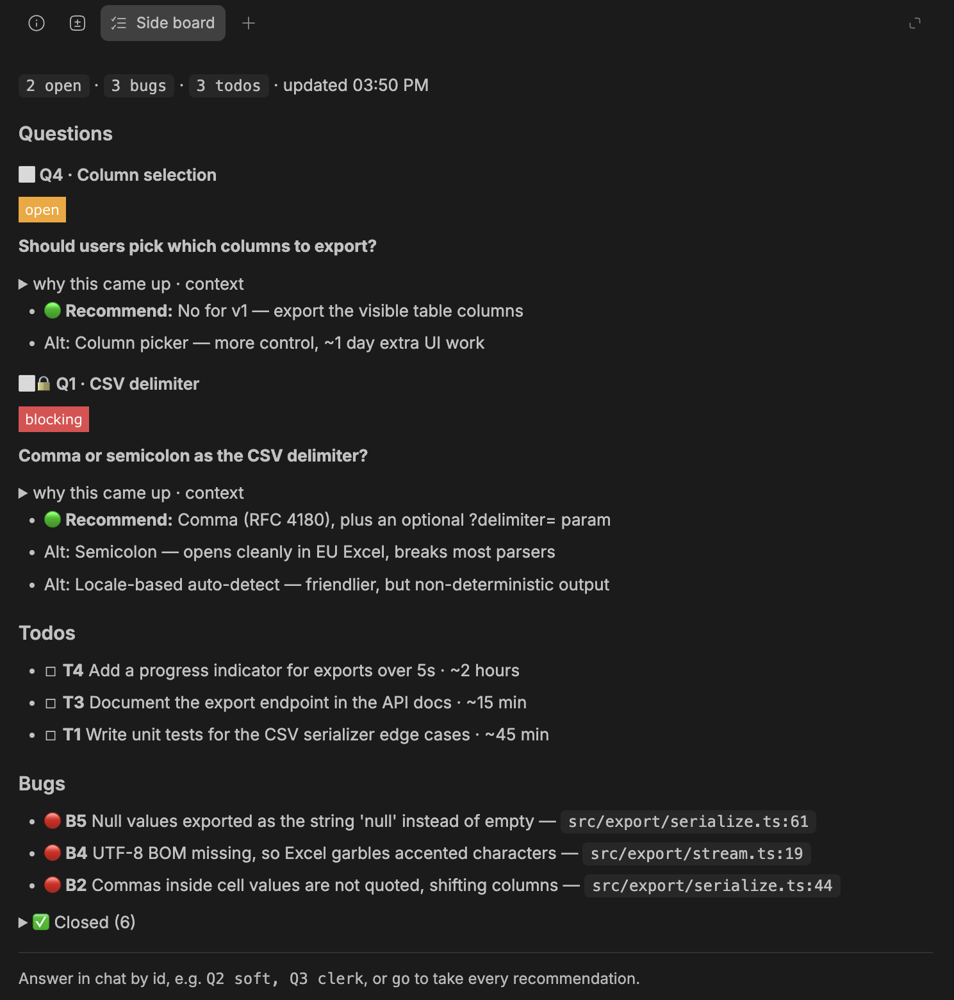

# bb-side-board

A [bb](https://getbb.app) plugin that keeps an overview of the questions your agents ask you.

Agents ask questions mid-reply, between a diff and a test run, and the questions scroll away.
You answer one, miss the next, and the agent waits on a decision you never saw. Side board pulls
every question into a panel beside the thread, numbered `Q1`, `Q2`, …, with the agent's
recommendation and alternatives. Answer in chat with `Q2 postgres`, or `go` to accept every
recommendation. The agent closes each question as soon as it is answered.

The same panel collects the bugs an agent noticed but was not asked to fix (`B1`) and the work it
deferred (`T1`). Open items come first; closed ones fold away with their resolution.



```
 agent turn ──► board_add / board_close / board_list   (agent tools)
     ▲                    │
     │ instructions       ▼
     │ (every thread)   bb.storage.kv  board:<threadId>
     │                    │ realtime
     │                    ▼
     │              ┌──────────────┐
     │              │ Side board   │  Questions · Bugs · Todos
     │              │ panel + badge│  read-only; answer in chat: "Q3 clerk" / "go"
     │              └──────────────┘
 thread.idle ──► safety net: reply raised or finished something
                 without touching the board → one reminder
```

## Install

```sh
bb plugin install git:https://github.com/devnoo/bb-side-board@semver:^0.1.0
```

Threads that are already running pick it up when their next session starts.

## Settings

| Key | Default | |
| --- | --- | --- |
| `nudge` | `true` | Remind an agent that asked a question, mentioned a bug or deferred work, or finished open work, without updating the board. One reminder per turn at most. |

`bb plugin config side-board set nudge false`

## Develop

```sh
npm install
npm test            # board logic
npm run typecheck
bb plugin build
bb plugin install path:$PWD   # then: bb plugin dev
```

| File | Role |
| --- | --- |
| `board.ts` | data model, id allocation, close, idle heuristics. Pure, unit-tested |
| `server.ts` | tools, contributed instructions, safety net, RPC + realtime |
| `app.tsx` | side-panel tab and header badge |
| `skills/side-board/SKILL.md` | the agent-facing contract |

The `components/ui/` files are vendored bb UI components (shadcn model).

## Release

Tag `vX.Y.Z` and push. `bb plugin update` follows the semver range. Never move a tag.

## License

MIT
